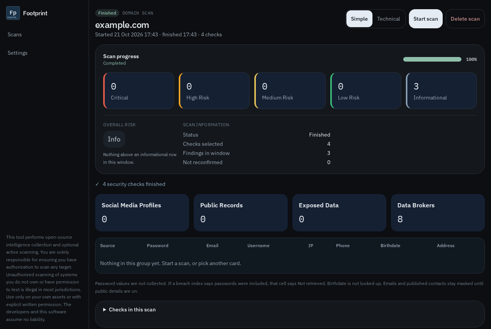

# Reading the results

Open an investigation from the home list. The tabs are Overview, Findings, Assets, Leaks, Footprint, Graph, and Report.

The picture above is sample data for `example.com`, so the counts are not a real assessment.

## Risk

The strip under scan progress counts findings, not “tests run.”

| Level | What usually lands here |
|---|---|
| Critical | A breach title, a malware association, a listed CVE, or a URLhaus hit. |
| High | A phone or street address published in a registration record, or an open port from InternetDB. |
| Medium | A mail gap such as missing SPF or DMARC, or a published role mailbox. |
| Low | A missing security header, or a cookie missing Secure or HttpOnly, on an authorized surface review. |
| Info | Profiles, DNS, certificates, ranks, and links. |

Overall risk is the highest level present. A finished email scan with breach titles shows Critical even when those rows were stored earlier as ordinary findings. Reload the investigation. You do not need to rescan for the score to update.

The count will be lower than a commercial breach report that lists one row per leaked source and shows password material. Footprint’s password column says **Not retrieved** on purpose.

## Overview

* Severity cards filter the Findings tab.
* Exposure cards filter the table: profiles, public records, exposed data. Data brokers jumps to the Footprint tab.
* The exposed-data table has Source, Password, Email, Username, IP, Phone, Birthdate, and Address. Empty cells stay empty. Footprint does not invent a row to fill a column.
* Public details (Settings) unmask a phone, address, or photo that a registry or profile API already published. It does not unlock passwords or identity numbers.

## Findings

Each row has what it means and how to fix it, when a fix is something you can do on a host you control. A breach row’s fix is to change reused passwords and turn on a second factor. The scan cannot show you the old password.

## Graph

The graph is the entities from this investigation and the links between them. It is a picture of what this scan stored, not a map of the internet.

## Report

Export Markdown, HTML, JSON, or CSV for the date range you have selected. Exports follow the public-details switch. If that switch is off, published phones, addresses, photos, and breach categories stay masked in the file.
