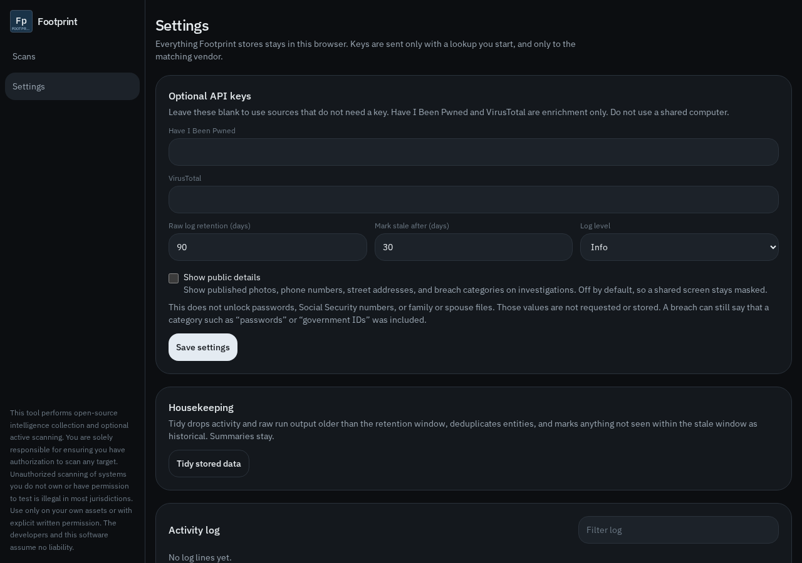

# Storage, keys, and limits

## Where data lives

Investigations, findings, monitors, the activity log, and settings are in the browser’s local storage under `footprint.vault.v1`. An older `fieldnote.vault.v1` store is copied across the first time Footprint opens.

That data is not in the Git repository. Cloning the repo does not bring your scans with it. Another browser, or a cleared site store, starts empty.

Exports are files you download yourself.

## Keys

| Setting | Effect |
|---|---|
| Have I Been Pwned key | Adds HIBP breach titles to an email scan. |
| VirusTotal key | Enables the VirusTotal module. |
| Public details | Unmasks published phones, addresses, photos, and breach categories in the investigation and in exports. Off by default. |
| Retention and stale days | Used when you clean historical rows. |

## Limits that are intentional

* No password values, no dump contents, no Social Security number lookup.
* No Tor, no onion crawl, no marketplace search.
* No live device location for a phone number.
* No port scan and no exploit check. InternetDB is someone else’s published observation.
* Username checks are a handful of public APIs, not every social network.
* Surface review is a few ordinary page reads, and only after you confirm authorization.
* Geolocation is city and network, not a rooftop.
* A profile hit means the name exists on that site. It does not prove who uses it.
* Schedules run only while Footprint is open in this browser.

## Legal

The app shows this on Settings, and the same idea on an investigation:

> This tool performs open-source intelligence collection and optional active scanning. You are solely responsible for ensuring you have authorization to scan any target. Unauthorized scanning of systems you do not own or have permission to test is illegal in most jurisdictions. Use only on your own assets or with explicit written permission. The developers and this software assume no liability.

The only active module is the authorized surface review. Everything else reads public sources or builds a link for you to open.
