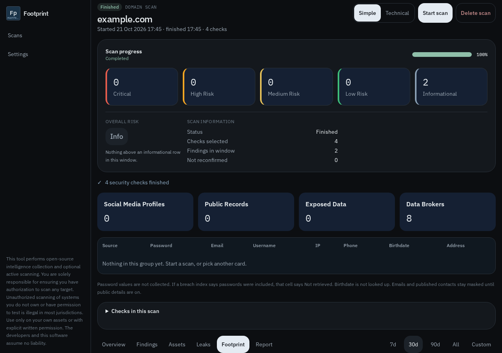

# Taking a listing down

**Remove from this scan** deletes a row in this browser. It does not contact the website. Clearing site data in the browser does not either.

The real request is on the investigation’s **Footprint** tab.

## Steps

1. Search your own name on the broker and copy every listing URL. One person often has several.
2. On the **Footprint** tab, paste one listing address. If it is Spokeo, BeenVerified, or Whitepages, the page says so. Enter the name on the listing and an email you can open, then use **Email the removal request**. The letter is copied and your mail app opens. Send it, then click the confirmation that site emails back. **Open the site’s form** is the other path. Footprint does not click the confirmation or pass a captcha.
3. After the listing is gone, use **Google Results about you** so the cached result drops. Google does not delete the broker’s copy.
4. If you live in California, file one [DROP](https://privacy.ca.gov/DROP) request, then still opt out of sites DROP does not cover. DROP is for California residents. It does not cover a Michigan address.
5. Look again in a few months. A new public record can recreate the listing.
6. If a form is ignored, use **Copy takedown request**. Send it to the site’s privacy contact. Attach the listing URL. Do not attach an identity number.

## Pages the tab already lists

* Search: Google Results about you.
* Brokers: Spokeo, PeopleConnect (Intelius, TruthFinder, Instant Checkmate, US Search), BeenVerified, Whitepages, TruePeopleSearch, FastPeopleSearch, LexisNexis, and California DROP.
* Phone, mail, and credit: National Do Not Call Registry, OptOutPrescreen, AnnualCreditReport, a freeze at Equifax, Experian, and TransUnion, IdentityTheft.gov, and Have I Been Pwned.

Have I Been Pwned can say a breach **included** the category “Social security numbers.” It does not return the number. Footprint does not look one up. People-search sites publish names, ages, addresses, phones, and sometimes relatives. A full Social Security number is not on the free public listing. If one appears in an old court or county PDF, ask that clerk to redact the filing. Search removal does not delete the document.

If a number is already being misused, freeze credit at all three bureaus and start at IdentityTheft.gov. Those links are on the same tab.
